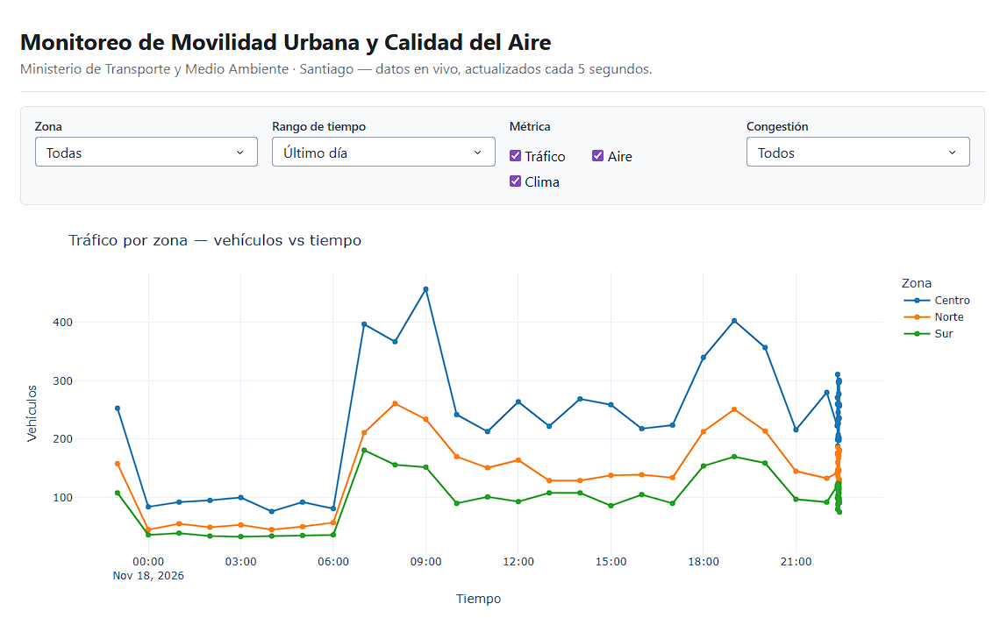
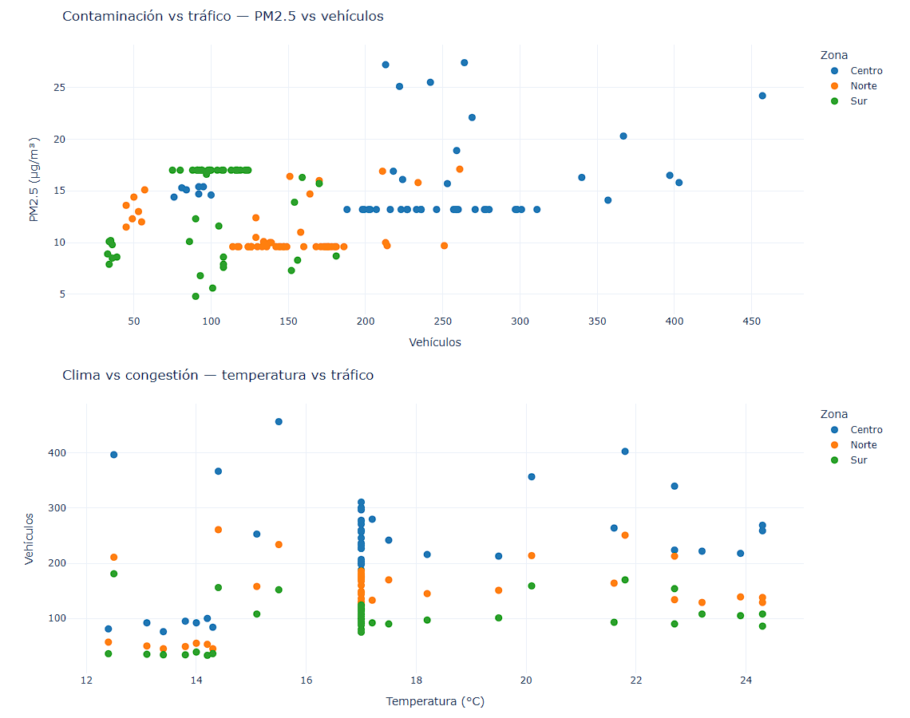

# Monitoreo de Movilidad Urbana y Calidad del Aire

Dashboard interactivo en tiempo real que monitorea **movilidad urbana** y **calidad del aire** por zona (Centro, Norte, Sur). Proyecto de la Unidad 3 del curso de Visualización de Datos, Universidad de Talca (2026-1).

**Autores:** Felipe Martínez Contreras y Jonathan Falcon




## Qué hace

- Muestra en un dashboard con refresco en vivo el estado de la movilidad, la calidad del aire (PM2.5, NO₂, O₃) y el clima.
- Incluye 3 visualizaciones: línea temporal de tráfico, PM2.5 vs. vehículos, y temperatura vs. tráfico.
- Ofrece 4 filtros interactivos: zona, rango de tiempo, métrica y congestión (esta última se deriva al vuelo, no se almacena).
- **Origen de los datos:** el clima y la calidad del aire provienen de [Open-Meteo](https://open-meteo.com/) (datos reales, sin API key), consultados para tres zonas de Santiago (Centro, Norte y Sur). El tráfico es **simulado**.
- **Calidad del aire, fuentes:** Open-Meteo Air Quality es la fuente por defecto; [OpenAQ](https://openaq.org/) v3 está implementado como fuente alternativa configurable (requiere API key e ids de estación en `.env`). Si la fuente primaria falla, se intenta la otra automáticamente.

## Stack

- **Python 3.12**: ingesta (scheduler) y dashboard. Entorno gestionado con `uv`.
- **SQLite**: un único archivo `db/monitoreo.sqlite`, compartido por el equipo.
- **Dash + Plotly** para visualización y **Pandas** para transformación.
- **APScheduler** para la ingesta continua y **requests** para las APIs.
- **pytest** para los tests (las pruebas no llaman a la red: usan mocks).
- **Docker + docker-compose** para la orquestación.

## Cómo ejecutarlo (Docker)

No requiere Python ni dependencias locales, solo Docker:

```bash
cp .env.example .env                     # 1. configuración (los valores por defecto sirven)
docker compose build                     # 2. construir la imagen
docker compose run --rm simulador \
  python -m db.sembrar_historico --limpiar   # 3. (opcional) sembrar 24 h de historial
docker compose up                        # 4. levantar simulador + dashboard
```

Se levantan dos servicios que comparten el archivo SQLite mediante un volumen:

- **simulador:** ingesta continua (`ingesta.scheduler`).
- **dashboard:** app Dash en [http://localhost:8050](http://localhost:8050).

Ambos contenedores usan la zona horaria `America/Santiago`.

## Cómo ejecutarlo (local)

Requiere Python 3.12 y [`uv`](https://docs.astral.sh/uv/).

```bash
uv venv --python 3.12
uv pip install -r requirements.txt
cp .env.example .env
uv run python db/init_db.py              # crea la base de datos
uv run pytest                            # tests
uv run python -m dashboard.app           # dashboard en http://localhost:8050
```

Para sembrar historial de 24 h con datos reales de Open-Meteo: `uv run python -m db.sembrar_historico --limpiar`. Sin conexión, usa `--fuente sintetico`.

## Estructura del proyecto

```
.
├── db/          # esquema SQLite, creación de la BD y siembra de historial
├── ingesta/     # consumo de APIs, simulador de tráfico y scheduler
├── datos/       # acceso a datos: conexión y repositorio de las 3 tablas
├── dashboard/   # app Dash + Plotly (layout, callbacks y vistas)
├── tests/       # tests con pytest
├── Dockerfile
├── docker-compose.yml
└── requirements.txt
```

## Modelo de datos

Tres tablas relacionadas por `timestamp` (y `zona` cuando aplica). El clima es global.

| Tabla               | Columnas                                           |
| ------------------- | -------------------------------------------------- |
| `Trafico`           | id, timestamp, zona, vehiculos, velocidad_promedio |
| `Calidad_Aire_Hist` | id, timestamp, zona, pm25, no2, o3                 |
| `Condiciones_Clima` | id, timestamp, temperatura, humedad, viento        |

## Qué aprendí

- Diseñar un pipeline de ingesta continua y separar responsabilidades por capas.
- Limpiar y normalizar datos antes de visualizarlos.
- Orquestar servicios con Docker Compose y probar con pytest.
